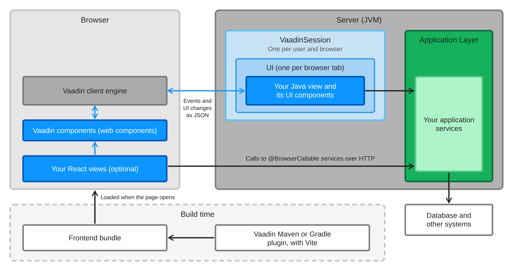
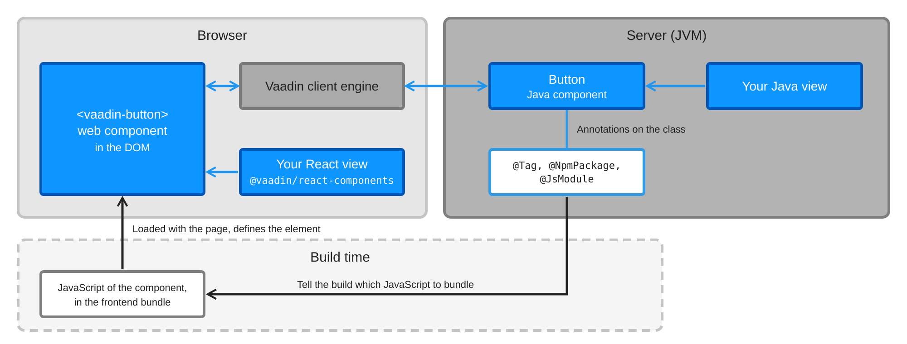

= Architecture Overview

An application with a Vaadin UI is a Java application with a web user interface. Some parts of it run in the browser, some on the server, and one part is produced when you build the application. You build the user interface from views. Typically, most of them are _Java views_, which run on the server. You can also add _React views_, which run in the browser. The following diagram shows all the parts, and how they communicate:

[.fill]
[link=images/overview.png]

The colors show where each part runs and which layer it belongs to. The blue boxes are the UI layer: your views, the Vaadin components, and the [classname]`VaadinSession` and [classname]`UI` objects drawn as light blue frames around your Java view. The Vaadin client engine, in gray, connects the browser to your Java views, and you don't write code for it. The green box is the application layer, with your application services. The dashed box shows what the Vaadin Maven or Gradle plugin produces when you build the application. <<layers#,Conceptual Layers>> explains why the UI layer of a view that runs on the server spans both the browser and the server.

== How a UI Component Works

A Vaadin component, such as a button, has two halves: a web component that the browser renders, and, for Java views, a Java class that you use on the server. The following diagram shows them for a button:

[.fill]
[link=images/component-architecture.png]

* *The web component* is a custom HTML element, such as `<vaadin-button>`. Its JavaScript comes from an npm package, and is part of the frontend bundle. The web component renders itself, and reacts to user input such as typing or hovering in the browser, without a round trip.
* *The Java component*, such as [classname]`Button`, is what a Java view uses. Its API -- [methodname]`setText()`, [methodname]`addClickListener()`, and so on -- changes the element in the browser and listens to its events.
* *The Vaadin client engine* keeps each Java component in sync with its web component in the browser. It applies the changes made on the server, and sends back the events that the server listens to.
* *Annotations* on the Java class connect the two halves: [annotationname]`@Tag` names the HTML element, and [annotationname]`@NpmPackage` and [annotationname]`@JsModule` tell the build which JavaScript the component needs.
* *A React view* uses the same web component through a React wrapper, such as `<Button>` from `@vaadin/react-components`. It doesn't involve the Java component or the Vaadin client engine.

<<{articles}/building-apps/ui-basics/compose#,Compose with Components>> shows how to use the Java components in a view. You can also build components of your own in the same way. See <<{articles}/building-apps/components#,Components>> for how-to guides, such as wrapping an existing web component, and the <<{articles}/flow/component-internals#,Component Internals>> reference for the details.

== In the Browser

In the browser, a *Vaadin component* is a web component, such as `<vaadin-button>` or `<vaadin-grid>`. Vaadin views use them to build the page that the user sees.

The *Vaadin client engine* is the part of Vaadin that runs in the browser on behalf of your Java views. It updates the page -- the Vaadin components and any other HTML elements -- as the server tells it to, and sends the user's events, such as clicks and changed field values, to the server. You don't write code for it.

*React views* are optional. If you write some views in React and TypeScript, they run entirely in the browser and use the same Vaadin components through their React wrappers. See <<{articles}/building-apps/react#,React Views>> for when they're a better fit than Java views.

== On the Server

The server runs your application in a JVM, for example as a Spring Boot application. Vaadin also works with Quarkus, Jakarta EE servers, and plain servlet containers.

For each user and browser, the server keeps a [classname]`VaadinSession`, which is tied to the HTTP session. It holds one [classname]`UI` for every browser tab that the user has open. The [classname]`UI` holds the Java view that the tab shows, as a tree of Java objects for the UI components on the page. This is where your Java views run. See <<{articles}/building-apps/views#,Views & Navigation>> for how to create them.

*Application services* are your business logic: ordinary Java classes, typically Spring beans, together with the repositories and other code behind them. They're shared by all users, and they talk to the database and to other systems.

== How Views Reach Your Services

Java views and React views reach your application services in different ways:

* *A Java view* runs on the server, so it calls an application service directly, as an ordinary Java method call. The Vaadin client engine and the server keep the page and the Java objects in sync by exchanging JSON messages: events go to the server, and the resulting changes to the UI come back. <<runtime-model#,How Vaadin Works at Runtime>> follows a single click through this cycle, and explains what it means for latency, threading, and deployment.
* *A React view* runs in the browser, so it calls a service over HTTP. You annotate the service with [annotationname]`@BrowserCallable`, and Vaadin generates a TypeScript client for it. See <<{articles}/building-apps/react/call-services#,Call Java Services from React Views>>.

Either way, you don't need to design a REST API for your own user interface.

== At Build Time

The JavaScript and CSS that the browser needs -- the Vaadin components, the Vaadin client engine, your React views, and your styles -- are packaged into a _frontend bundle_. The browser loads it when it opens the application. In a production build, the Vaadin Maven or Gradle plugin creates the bundle with https://vite.dev/[Vite], or uses a pre-compiled bundle when the application doesn't need one of its own. <<{articles}/flow/production/production-build#,Production Build>> describes when each one is used, and <<{articles}/flow/configuration/development-mode#,Development Mode>> describes how the frontend is served during development.

== Where to Go Next

* <<runtime-model#,How Vaadin Works at Runtime>> -- where the UI state lives, and what each interaction costs.
* <<layers#,Conceptual Layers>> -- the UI layer and the application layer in more detail.
* <<monoliths#,Monoliths>> and <<microservices#,Microservices>> -- how to structure the application as a whole.
* <<project-structure#,Project Structure>> and <<packages#,Package Structure>> -- how to organize the code.
