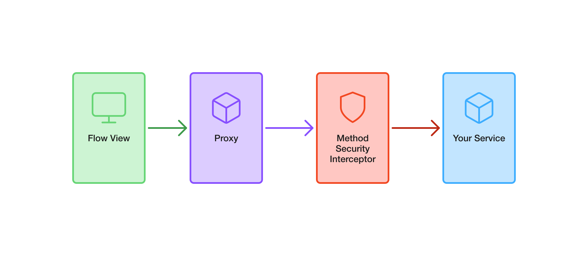

= Protect Services

A secure application relies on multiple layers of protection, including both views and application services. Even when your views are protected, you should also protect the application services. This is important if you have views that allow users with different roles to do different things. If you, for instance, forget to disable a button for users lacking a particular role, and don't protect your services, you have created a privilege escalation. See <<protect-views#controlling-access-within-views,Controlling Access within Views>> for how to restrict what users can do inside a view.

== Introducing Method Security

In a Flow application, services are standard Spring beans that are injected into views and used directly. Since services are accessed directly from views, they must be secured at the method level using *Spring method security*. Browser-callable services that React views call are protected differently. See <<../react/security#protecting-browser-callable-services,Secure React Views>> for details.

Spring Security protects services by creating a proxy that intercepts method calls. This ensures access control is enforced before execution, as shown in the following diagram:

In this guide, you'll only learn the minimum to get started with Spring method security in a Vaadin application. For more in-depth information, see the https://docs.spring.io/spring-security/reference/servlet/authorization/method-security.html[Spring Security Reference Manual].

== Enabling Method Security

To enable method security, add [annotationname]`@EnableMethodSecurity` to your security configuration class:

.`SecurityConfig.java`
[source,java]
----
@EnableWebSecurity
// tag::snippet[]
@EnableMethodSecurity
// end::snippet[]
@Configuration
class SecurityConfig {

    @Bean
    SecurityFilterChain securityFilterChain(HttpSecurity http) throws Exception {
        http.with(VaadinSecurityConfigurer.vaadin(), configurer -> {
            configurer.loginView(LoginView.class);
        });
        return http.build();
    }
    ...
}
----

.Test the method security
[CAUTION]
Without [annotationname]`@EnableMethodSecurity`, *all services remain unprotected* -- even if you annotate methods with security rules. Always verify that method security is enabled with automatic tests, as shown in <<#testing-method-security,Testing Method Security>>.

== Securing the Services

Spring Security uses different annotations to secure your services. The most flexible ones, which are enabled by default, are [annotationname]`@PreAuthorize`, [annotationname]`@PostAuthorize`, [annotationname]`@PreFilter`, and [annotationname]`@PostFilter`. In this guide, you'll only learn how to use [annotationname]`@PreAuthorize`.

You can annotate both *service classes* and individual *service methods*. An annotation placed on the class applies to *all public methods* of the class. An annotation placed on a method *overrides any annotation on the class*.

[annotationname]`@PreAuthorize` takes as its single argument a Spring Expression Language (SpEL) expression that must evaluate to `true` to grant access. Although you can do some quite advanced things with SpEL, the most common methods you'll want to use are:

* `permitAll` allows *anyone* to call the method.
* `isAuthenticated` allows any *authenticated* user to call the method.
* `hasRole` / `hasAnyRole` allows users *having the roles* specified to call the method.
* `denyAll` prevents *anyone* from calling the method.

You use the SpEL methods like this:

[source,java]
----
@Service
// tag::snippet[]
@PreAuthorize("isAuthenticated()") // <1>
// end::snippet[]
public class ProtectedService {

    public void callableByAllUsers() { // <2>
    }

// tag::snippet[]
    @PreAuthorize("hasRole('" + Roles.ADMIN + "')") // <3>
// end::snippet[]
    public void callableByAdminsOnly(MyData data) {
    }
}
----
<1> Allows all authenticated users to call the service by default.
<2> Inherits its access permissions from the class-level annotation.
<3> Overrides the class-level annotation to allow access to administrators only. Note the single quotes `'` around the role name.

== Testing Method Security

Because services are ordinary Spring beans, you can test their security rules with plain Spring Boot tests, without involving any views. Add the Spring Security test dependency to your project, if it isn't there already:

[source,xml]
----
<dependency>
    <groupId>org.springframework.security</groupId>
    <artifactId>spring-security-test</artifactId>
    <scope>test</scope>
</dependency>
----

Then call the service as different users, and check that the calls that should be denied throw an [classname]`AccessDeniedException`:

[source,java]
----
@SpringBootTest
class ProtectedServiceTest {

    @Autowired
    ProtectedService service;

    @Test
    @WithAnonymousUser // <1>
    void anonymous_users_cannot_call_the_service() {
        assertThrows(AccessDeniedException.class,
            () -> service.callableByAllUsers());
    }

    @Test
    @WithMockUser(roles = Roles.USER) // <2>
    void users_cannot_call_admin_methods() {
        assertThrows(AccessDeniedException.class,
            () -> service.callableByAdminsOnly(new MyData()));
    }

    @Test
    @WithMockUser(roles = Roles.ADMIN)
    void admins_can_call_admin_methods() {
        assertDoesNotThrow(() -> service.callableByAdminsOnly(new MyData()));
    }
}
----
<1> Runs the test as an anonymous user. Without an annotation like this, there's no authentication at all, and Spring Security throws a different exception.
<2> Runs the test as an authenticated user with the `USER` role.

If [annotationname]`@EnableMethodSecurity` is missing, the first two tests fail, because nothing stops the calls. The tests therefore protect you against both a missing configuration and a mistake in the security rules.

To test that your views are protected, see <<../testing/browserless/test-view-access#,Test View Access Control>>.

== Protecting Individual Records

Roles decide what users may do in general, such as editing customers. Many applications also have rules about individual records: a sales representative may edit the customers they manage, but not the customers of other representatives.

Enforce such rules in the application service as well. Load the record, and check the rule against what's stored:

[source,java]
----
@Service
@Transactional(readOnly = true)
@PreAuthorize("isAuthenticated()")
public class CustomerCrudService {

    private final CustomerRepository repository;

    CustomerCrudService(CustomerRepository repository) {
        this.repository = repository;
    }

    @Transactional
    public CustomerForm update(CustomerForm customerForm) {
        var entity = repository.findById(customerForm.id()).orElseThrow();
// tag::snippet[]
        if (!mayEdit(entity)) { // <1>
            throw new AccessDeniedException("Not allowed to edit customer " + entity.getId());
        }
// end::snippet[]
        entity.setName(customerForm.name());
        ...
        return toCustomerForm(repository.saveAndFlush(entity));
    }

// tag::snippet[]
    private static boolean mayEdit(Customer customer) {
        var user = SecurityContextHolder.getContext().getAuthentication();
        return customer.getAccountManager().equals(user.getName()) // <2>
                || AuthorityUtils.authorityListToSet(user.getAuthorities())
                        .contains("ROLE_" + Roles.ADMIN); // <3>
    }
// end::snippet[]
    ...
}
----
<1> Checks the stored record, so the rule holds regardless of what the view sends.
<2> [methodname]`getName()` returns the user name when users log in with a login form, and the subject identifier of the provider when they log in through an <<connect-identity-provider#,identity provider>>. Store the same value in the record.
<3> Administrators may edit every customer.

The [classname]`AccessDeniedException` reaches the view in the same way as when [annotationname]`@PreAuthorize` denies a call. See <<../ui-basics/handle-errors#access-denied-by-a-service,Handle Errors>> for how to show it to the user. The view should still offer only the actions that the user may perform, as described in <<protect-views#,Protect Views>>, but the check in the service is what protects the data.

A [annotationname]`@PreAuthorize` expression can also call a bean of your own, as described in the https://docs.spring.io/spring-security/reference/servlet/authorization/method-security.html#_using_a_custom_bean_in_spel[Spring Security reference]. However, the expression only sees the method arguments, so the bean has to load the record a second time.

=== Filtering Lists

For lists, apply the rule in the query, so that users only receive the records they may see:

[source,java]
----
public List<Customer> findMyCustomers(Pageable pageable) {
    var user = SecurityContextHolder.getContext().getAuthentication();
    return repository.findByAccountManager(user.getName(), pageable);
}
----

Don't load the records first and filter them afterward, for example with Spring Security's [annotationname]`@PostFilter`. That breaks paging, since each page then contains fewer records than requested. It also loads records that the user isn't allowed to see.

=== Testing Record Rules

Test record rules in the same way as roles. The `username` attribute of [annotationname]`@WithMockUser` sets the value that [methodname]`getName()` returns:

[source,java]
----
@SpringBootTest
class CustomerCrudServiceTest {

    @Autowired
    CustomerCrudService service;

    @Autowired
    CustomerRepository repository;

    @Test
    @WithMockUser(username = "alice", roles = Roles.USER)
    void users_cannot_edit_customers_of_others() {
        var customer = repository.save(new Customer("Acme", "bob")); // <1>
        assertThrows(AccessDeniedException.class,
            () -> service.update(new CustomerForm(customer.getId(), "Acme Inc.")));
    }
}
----
<1> A customer that `bob` manages.

[[tenant-isolation]]
== Tenant Isolation

Some applications serve several organizations, or _tenants_, whose data has to stay apart. Vaadin leaves tenant isolation to the application, and these guides don't cover it. If you build a multi-tenant application, plan for the following:

* *Data.* Keep the data of each tenant in a separate database, in a separate schema, or in shared tables with a tenant column. With a tenant column, every query needs a filter like the one in <<#filtering-lists,Filtering Lists>>, and a single missing filter exposes the data of another tenant. Hibernate supports all three approaches, as described in the https://docs.hibernate.org/orm/current/userguide/html_single/#multitenacy[Hibernate User Guide].
* *Shared state.* In-memory state that isn't tied to a user's session is shared by all tenants. This includes singleton beans, caches, and the signals in <<../server-push/updates#broadcasting-to-all-users,Broadcasting to All Users>>. Keep such state per tenant.
* *Background threads.* The current user, and with it the tenant, isn't available in background threads, as explained in <<../architecture/runtime-model#threads-and-the-session-lock,Threads and the Session Lock>>. Pass the tenant to background jobs explicitly.
* *Identity.* Decide how the application learns the tenant of a user. An identity provider can send it as a claim in the ID token, like the roles in <<connect-identity-provider#map-the-providers-roles,Map the Provider's Roles>>.
