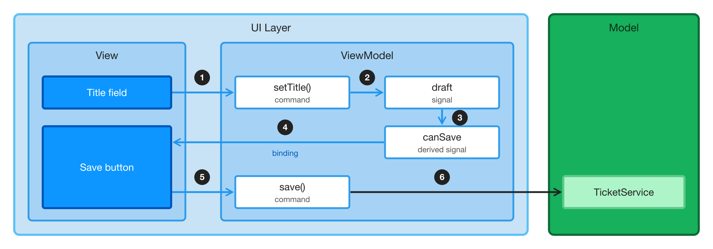

= Structure Complex Views with MVVM

As a view grows, its state and its rules spread across listeners. A listener on the grid updates the form, a listener on the form enables the button, and a third one keeps the two in step. Before long, nobody can tell which listener sets what, and the only way to test a rule is to click through the view.

The Model-View-ViewModel (MVVM) pattern moves that state and those rules out of the view, into a class of their own called the ViewModel. The view binds its UI components to the ViewModel, and passes the user's actions to it. The following diagram shows a view that edits the title of a ticket:

. The user types in the title field. The field passes the new title to the [methodname]`setTitle()` command of the ViewModel.
. The command updates the `draft` signal, which holds the ticket that the user is editing.
. The `canSave` signal is derived from the draft, so it changes with it.
. The *Save* button is bound to `canSave`, so the button is enabled or disabled without any code in the view.
. When the user clicks *Save*, the button calls the [methodname]`save()` command.
. The command passes the ticket to the `TicketService`, which saves it.

In code, the ViewModel looks like this:

[source,java]
----
class TicketEditorViewModel {

    private final TicketService ticketService; // The Model
    private final ValueSignal<Ticket> draft; // The state

    TicketEditorViewModel(TicketService ticketService, Ticket ticket) {
        this.ticketService = ticketService;
        this.draft = new ValueSignal<>(ticket);
    }

    Signal<String> title() {
        return draft.map(Ticket::title);
    }

    // A rule, derived from the state
    Signal<Boolean> canSave() {
        return draft.map(ticket -> !ticket.title().isBlank());
    }

    // Commands: what the user can do
    void setTitle(String title) {
        draft.update(ticket -> ticket.withTitle(title));
    }

    void save() {
        ticketService.save(draft.peek());
    }
}
----

The view creates the ViewModel, and binds its UI components to it once:

[source,java]
----
var viewModel = new TicketEditorViewModel(ticketService, ticket);

TextField title = new TextField("Title");
title.bindValue(viewModel.title(), viewModel::setTitle);

Button save = new Button("Save", event -> viewModel.save());
save.bindEnabled(viewModel.canSave());
----

<<{articles}/flow/ui-state#,Signals>> make the pattern cheap in Flow. Every change reaches the screen through the bindings, without listeners that copy values around. Because the ViewModel has no UI components, you can test its rules, such as "a ticket with a blank title can't be saved", with plain JUnit tests that run in milliseconds.

This example is small enough not to need a ViewModel; <<#when-to-use-mvvm,When to Use MVVM>> explains when one pays off. The guides in this series build a larger view that does.

== The Roles

[cols="1,3,2",options="header"]
|===
|Part |What It Does |In the Example

|View
|Creates the UI components and lays them out. It shows what the ViewModel holds, and tells the ViewModel what the user does.
|The title field and the *Save* button

|ViewModel
|Remembers the state of the view, such as the ticket that the user is editing, and decides what the view shows, such as whether *Save* is enabled. It has no UI components.
|`draft`, `canSave`, [methodname]`setTitle()`, and [methodname]`save()`

|Model
|The rest of the application: the services that load and save data, and the data itself. It knows nothing about the view.
|The `TicketService`, and the `Ticket` record
|===

Each part uses only the one next to it: the view uses the ViewModel, and the ViewModel uses the Model. Because the ViewModel never uses UI components, you can test it on its own.

The Model is the same no matter how the view is built. The <<{articles}/building-apps/business-logic/add-service#,Add a Service>> guide shows how to build application services.

== When to Use MVVM

Most views don't need a ViewModel. Pick the lightest approach that keeps each view readable, and decide for each view rather than for the whole application. A mix of approaches in one application is normal.

[cols="1,2,2",options="header"]
|===
|Approach |What It Is |Fits

|Plain view
|UI components, listeners, and service calls, with [classname]`Binder` for forms
|A login view, a settings view, a form that loads and saves one entity, a list with one filter, or a read-only page

|Signals in the view
|[classname]`ValueSignal` fields in the view class, bound to UI components
|A few pieces of UI state that more than one UI component reads: a toggle, a filter, the selected item, or a dashboard's latest data

|View and ViewModel
|The signals and the rules move to a ViewModel class that the view creates
|A view that shows at least two of the signs listed in this section
|===

A signal earns its place when a second UI component reads the state. A search field that filters one grid needs only a value change listener. The <<../add-master-detail#,master-detail view>> is an example of signals in the view: one signal holds the selection, and the detail follows it.

Move to a ViewModel when *at least two* of the following hold:

Rules over combined state::
What's visible, enabled, or shown depends on more than one piece of state: "Save is enabled when the ticket has changes and is valid."

State shared by parts of the view::
The view is split into parts -- a filter bar, a list, a detail panel, a toolbar, wizard steps -- that read or change the same state. Usually, each part is a child UI component of its own; see <<{articles}/building-apps/ui-basics/compose#decomposing-a-view,Decomposing a View>>. A field and the grid it filters aren't parts in this sense.

Behavior worth a unit test::
You can state a rule about the view without naming a UI component, such as "switching tickets with unsaved changes asks first", and the rule deserves a test.

Flows and modes::
The view has wizard steps, view and edit modes, guards against losing unsaved changes, or confirmations before it continues.

State that changes without a click::
The view loads data in the background, polls for it, or receives updates pushed from the server.

A ViewModel is overkill when:

- It would only forward calls: each command is one service call, and nothing is derived.
- Each piece of state is used by exactly one UI component.
- The view is a form that loads one entity and saves it, with no rules beyond validating each field. [classname]`Binder` already does that job; see <<{articles}/building-apps/forms-data/add-form#,Add a Form>>. A wizard, or an editor with totals, lines, or guards, isn't such a form, even if it saves one entity.
- The view is a prototype that you're going to throw away.

If you're unsure, write down the ViewModel's public API first: the signals it exposes, and its commands. Then strike out what a plain view gets for free: a signal for each form field, and a command that only passes a value to a service. If nothing is left -- no derived signal that combines state, no guard, no flow -- the view doesn't need a ViewModel.

When a view with signals outgrows them, moving to a ViewModel is mechanical. Move the signal fields, and the code that changes them, into a ViewModel class. Then make the fields private, and expose read-only signals and commands instead.

If your application already uses the Model-View-Presenter pattern, see <<../mvp#,MVP and MVVM Compared>>. It discusses when to keep MVP, and how to move a view from MVP to MVVM.

== The Example

The guides in this series build a larger version of the ticket editor: a ticket triage view for a support desk. The view lists tickets next to an editor for the selected ticket, and has these rules:

- Searching and filtering by status narrow the list.
- Clicking a ticket opens it in the editor. *Save* is enabled only when the ticket has changes and its title isn't blank. A blank title shows an error on the field.
- Clicking another ticket while there are unsaved changes asks the user first. *Discard* opens the clicked ticket, and *Keep editing* selects the ticket being edited again.
- Saving keeps the ticket open and selected, and updates its row in the list.
- Leaving the view with unsaved changes asks the user first, too.

Together, these rules show most of the signs listed in the previous section: the list and the editor share state, *Save* depends on combined state, and switching tickets is a flow that's worth a unit test.

== Topics

section_outline::[]
