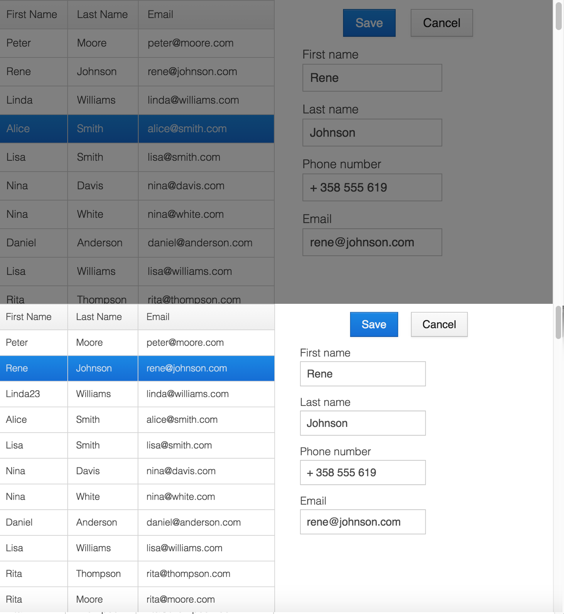

= Loading and Connection Indicator

Vaadin shows a loading bar at the top of the page when a request to the server takes a while. When the browser loses its connection to the server, Vaadin shows a status message. Both are parts of the `<vaadin-connection-indicator>` element, which Vaadin adds to the page. Flow and React views share the element: it shows the requests of Flow views, and the calls that React views make to browser-callable services.

section_outline::[]

[[loading-bar]]
== Loading Bar

The loading bar appears when a request takes longer than the first delay. It then goes through three stages, each with a CSS class name:

[cols="1,1,3"]
|===
|Class Name |Default Delay |Default Appearance

|`first`
|450 ms
|The bar appears.

|`second`
|1500 ms
|The bar grows longer.

|`third`
|5000 ms
|The bar gets thicker and starts to pulse.
|===

Each delay counts from the start of the request. The bar disappears when the request ends.

In React views, a call with the `mute` request option doesn't show the loading bar. See <<{articles}/flow/react-views/browser-callable-services#request-options,Request Options>>.

[[status-message]]
== Connection Status Message

When the browser loses its connection to the server, the indicator shows a status message at the top of the page:

- While Vaadin tries to reconnect, it shows the reconnecting text.
- When Vaadin gives up, or the browser goes offline, it shows the offline text.

The message shows in full for two seconds by default, and then shrinks to a thin bar. The bar expands again when the user hovers over it. When the connection comes back, the indicator shows the online text for the same time.

Flow views try to reconnect when a request fails. In React views, a failed call to a browser-callable service shows the offline text, and the next successful call ends it.

[[java]]
== Configuring from Java

Flow views get their configuration from two objects of the [classname]`UI`:

[methodname]`getLoadingIndicatorConfiguration()`::
The delays of the loading bar, and whether the default styles apply.

[methodname]`getReconnectDialogConfiguration()`::
The reconnecting text, set with [methodname]`setDialogText()`, and the offline text, set with [methodname]`setDialogTextGaveUp()`. It also has the number of reconnect attempts and the interval between them.

To configure every UI, use a UI init listener. Register it as described in <<service-init-listener#,Service Init Listener>>:

[source,java]
----
include::{root}/src/main/java/com/vaadin/demo/flow/advanced/loadingindicator/IndicatorConfigurationListener.java[tags=snippet,indent=0]
----

The configuration reaches the browser when Vaadin creates the UI, which happens when the browser first shows a Flow view. It changes only the properties that it sets. Before that, and in applications with only React views, the configuration from TypeScript applies.

[[typescript]]
== Configuring from TypeScript

Set the properties of `connectionIndicator` in the entry point of the frontend, [filename]`src/main/frontend/index.tsx`. Vaadin generates a default entry point, so first copy it there, as described in <<modifying-the-bootstrap-page#default-bootstrap-template-and-entry-point,Default Template and Entry Point>>.

[source,tsx]
.[filename]`src/main/frontend/index.tsx`
----
import { connectionIndicator } from 'Frontend/generated/jar-resources/ConnectionIndicator.js';

connectionIndicator.firstDelay = 300; // Milliseconds
connectionIndicator.onlineText = 'Online again';
connectionIndicator.offlineText = 'Offline';

// The rest of the generated file
----

The properties and their defaults are:

[cols="2,2,3"]
|===
|Property |Default |Description

|`firstDelay`
|`450`
|The delay in milliseconds before the loading bar appears with the `first` class name.

|`secondDelay`
|`1500`
|The delay before the loading bar gets the `second` class name.

|`thirdDelay`
|`5000`
|The delay before the loading bar gets the `third` class name.

|`expandedDuration`
|`2000`
|How long, in milliseconds, a new status message shows in full.

|`onlineText`
|`Online`
|The message when the connection comes back.

|`reconnectingText`
|`Connection lost, trying to reconnect...`
|The message while Vaadin tries to reconnect.

|`offlineText`
|`Connection lost`
|The message when Vaadin gives up reconnecting, or the browser is offline.

|`applyDefaultTheme`
|`true`
|Whether the default styles apply. See <<styling>>.
|===

[[styling]]
== Styling the Indicator

The indicator has the following structure. The element has the `loading`, `reconnecting`, `offline` and `expanded` attributes while it's in these states. When no request is in progress, the loading bar has `display: none` set as an inline style.

[source,html]
----
<vaadin-connection-indicator offline expanded>
  

  

    Connection lost
  

</vaadin-connection-indicator>
----

To style the indicator yourself, turn off the default styles, either from Java with [methodname]`setApplyDefaultTheme(false)` or from TypeScript with `applyDefaultTheme = false`. The indicator is then invisible until your styles show it. Vaadin hides it with `opacity: 0` and `pointer-events: none` for the `.v-loading-indicator` and `.v-status-message` selectors, which come after your stylesheets. Set these properties with a more specific selector, such as `vaadin-connection-indicator .v-loading-indicator`.

[[modal-curtain]]
=== Modal Curtain

The following styles show the loading bar as a curtain that darkens the whole page. The darkening fades in, starting 200 milliseconds after the loading bar appears, so that the page doesn't flicker on short requests:

[source,css]
----
vaadin-connection-indicator .v-loading-indicator {
  position: fixed; /* Covers the whole page, even when scrolled */
  inset: 0;
  opacity: 1;
  /* Blocks clicks while the curtain is visible, but not scrolling */
  pointer-events: auto;
  animation: fadein 0.3s ease-out 0.2s normal 1 both;
  z-index: 2147483647;
}

@keyframes fadein {
  0% {
    background: rgba(0, 0, 0, 0);
  }
  100% {
    background: rgba(0, 0, 0, 0.5); /* Darkens the page */
  }
}
----

The following image shows an application with the curtain during loading at the top, and in its normal state at the bottom:

[[changing-indicator]]
=== Changing Indicator

The stage class names can change the look of the loading bar as the user waits. The following styles show a pulsing circle in the middle of the page, which changes color in each stage:

[source,css]
----
vaadin-connection-indicator .v-loading-indicator {
  position: fixed;
  inset: 0;
  opacity: 1;
  pointer-events: auto;
  z-index: 2147483647;
}

vaadin-connection-indicator .v-loading-indicator::before {
  width: 76px;
  height: 76px;
  position: absolute;
  top: 50%;
  left: 50%;
  margin: -38px 0 0 -38px;
  border-radius: 100%;
  animation: bouncedelay 1.2s infinite 0.4s ease-in-out both;
  content: "";
}

vaadin-connection-indicator .v-loading-indicator.first::before {
  background-color: skyblue;
}

vaadin-connection-indicator .v-loading-indicator.second::before {
  background-color: salmon;
}

vaadin-connection-indicator .v-loading-indicator.third::before {
  background-color: red;
}

@keyframes bouncedelay {
  0%, 80%, 100% {
    transform: scale(0);
  }
  40% {
    transform: scale(1);
  }
}
----

[discussion-id]`6C6BB934-E210-45D7-9BF2-6FDACF7E7891`
