= Navigation Access Control

Navigation access control decides, for every navigation, whether the current user may open the target view. It evaluates a set of pluggable rules -- such as the access annotations described in <<index#,View Access Control>> -- and then either renders the view, redirects the user to the log-in view, or shows an error view.

== Architecture

The Navigation Access Control mechanism is composed of three fundamental components: [classname]`NavigationAccessControl`; [interfacename]`NavigationAccessChecker`; and [interfacename]`AccessCheckDecisionResolver`.

[classname]`NavigationAccessControl` is the entry point for navigation security. It listens for navigation events, and it evaluates all security rules. Based on the results, it allows or denies access to the target view.

[interfacename]`NavigationAccessChecker` interface implementers represent the security rules that are evaluated during a navigation event.

[interfacename]`AccessCheckDecisionResolver` has the responsibility of taking the final decision to allow or deny a navigation, based on the result of the evaluation of the security rules.

[.fill.white]
[link=images/navigation_access_control.svg]

[classname]`NavigationAccessControl` can be configured to evaluate multiple [interfacename]`NavigationAccessChecker`. For example, you can enable annotation-based view access check and path-based access check. During a navigation request, both checkers are evaluated against the current [classname]`NavigationContext` and they produce an [classname]`AccessCheckResult`.

The [interfacename]`AccessCheckDecisionResolver` analyzes the results and provides the final decision. The access control uses that decision to proceed with the navigation or reroute to the login view or to an error page.

=== Access Check Results

Each navigation access checker returns an [classname]`AccessCheckResult`, which holds the decision taken by the checker -- and potentially an informative reason about the decision. The decision can be `ALLOW`, `DENY`, `NEUTRAL`, or `REJECT`. `ALLOW` and `DENY` are self-explanatory. `NEUTRAL` means that the checker doesn't have enough information to make a decision, and it delegates the responsibility to the other configured checkers. `REJECT` has the same meaning of `DENY`, but it's used to signal a critical situation where the checker cannot make the decision because of a system configuration error.

In development mode, a rejection is handled by throwing an exception so that the situation can be detected immediately. The [classname]`AccessCheckResult` object is created by calling its factory methods [methodname]`allow`, [methodname]`deny`, [methodname]`neutral`, or [methodname]`reject`. Alternatively, the same methods can be called on [classname]`NavigationContext` instance.

== Built-in Access Checkers

Flow provides two implementations of the [interfacename]`NavigationAccessChecker` interface.

=== AnnotatedViewAccessChecker

[classname]`AnnotatedViewAccessChecker` looks for an access annotation ([annotationname]`@AnonymousAllowed`, [annotationname]`@PermitAll`, [annotationname]`@RolesAllowed`, or [annotationname]`@DenyAll`) on the target view class. It evaluates them against the current navigation context. [classname]`AnnotatedViewAccessChecker` delegates the check to an instance of [classname]`AccessAnnotationChecker`, that can be extended to provide custom rules.

=== RoutePathAccessChecker

[classname]`RoutePathAccessChecker` evaluates the path used to navigate to a view. It requires an implementation of [interfacename]`AccessPathChecker`, that is responsible for the effective path verification. Vaadin's Spring integration provides an implementation that evaluates the path against the Spring Security configuration, as described in <<#url-pattern-based-security,URL-Pattern-Based Security>>. For other security frameworks, provide your own [interfacename]`AccessPathChecker` implementation.

== Decision Resolver

The [interfacename]`AccessCheckDecisionResolver` component is responsible for analyzing the results provided by the navigation access checkers, and for computing the final decision to grant or deny access to a view.

The default implementation makes the decision by applying the following rules:

.Default Decision Resolver Rules
[cols="1,1"]
|===
| Navigation Access Checkers Results | Decision

| `ALL ALLOW`              | `ALLOW`
| `ALLOW + NEUTRAL`        | `ALLOW`
| `ALL DENY`               | `DENY`
| `DENY + NEUTRAL`         | `DENY`
| `ALL NEUTRAL`            | `DENY`
| `ALLOW + DENY`           | `REJECT`
| `ALLOW + DENY + NEUTRAL` | `REJECT`
|===

As shown in the above table, if the navigation access checkers do not agree on the decision -- excluding neutral votes -- the default resolver rejects the navigation, causing an exception to be thrown in development mode. This situation happens usually because of invalid security configurations. For example, a view may be annotated with [annotationname]`@AnonymousAllowed`, but the Spring Security configuration has a request matcher for the view path that grants access only to an authenticated user.

In error handling phase, almost the same rule applies with the exception that if all the results are `NEUTRAL`, the access is granted.
The reason is that, in this case, the target of the navigation is supposed to be an error handler component that do not expose sensible information.

.Default Decision Resolver Rules For Error Handling Phase
[cols="1,1"]
|===
| Navigation Access Checkers Results | Decision

| `ALL ALLOW`              | `ALLOW`
| `ALLOW + NEUTRAL`        | `ALLOW`
| `ALL NEUTRAL`            | `ALLOW`
| `ALL DENY`               | `DENY`
| `DENY + NEUTRAL`         | `DENY`
| `ALLOW + DENY`           | `REJECT`
| `ALLOW + DENY + NEUTRAL` | `REJECT`
|===

== Configuration

In a Spring application, [classname]`VaadinSecurityConfigurer` enables navigation access control automatically. In a plain servlet application, a [interfacename]`VaadinServiceInitListener` enables it, as described in <<../plain-servlet/setup#,Setting Up Security>>. The following sections show how to customize it.

=== Spring Applications

When using [classname]`VaadinSecurityConfigurer` for configuring Spring Security, the Navigation Access Control feature is enabled by default. You can disable it by calling the [methodname]`enableNavigationAccessControl(false)` method on the configurer. By default, only the [classname]`AnnotatedViewAccessChecker` is active.

For a fine-grained configuration, you can expose a bean of type [classname]`NavigationAccessControlConfigurer`. [classname]`NavigationAccessControlConfigurer` allows activating out-of-the-box navigation access checkers or adding new ones, providing a custom decision resolver, completely disable the functionality, etc.

[NOTE]
If [classname]`VaadinSecurityConfigurer` is not used, exposing the [classname]`NavigationAccessControlConfigurer` bean is mandatory to activate navigation access control.

In the following example, Navigation Access Control is configured to activate route path checker, a custom checker instance and all available [interfacename]`NavigationAccessChecker` beans that extend [classname]`VotingNavigationAccessChecker`. It also provides a custom decision resolver.

.Customize NavigationAccessControl in Spring Project
[source,java]
----
@Bean
NavigationAccessControlConfigurer navigationAccessControlConfigurerCustomizer() {
    return new NavigationAccessControlConfigurer()
            .withRoutePathAccessChecker() // <1>
            .withNavigationAccessChecker(new CustomChecker()) // <2>
            .withAvailableNavigationAccessCheckers(checker ->
                checker instanceof VotingNavigationAccessChecker  // <3>
            )
            .withDecisionResolver(new CustomDecisionResolver()); // <4>
}
----
<1> Activates the route path access checker. The implementation is provided by the Vaadin Spring module and exposed as a bean.
<2> Adds a custom navigation access checker, by creating a new instance.
<3> Activates all registered navigation access checker bean, that matches the predicate.
<4> Sets a custom decision resolver.

[IMPORTANT]
When using [classname]`VaadinSecurityConfigurer` in the same configuration class where you define the [classname]`NavigationAccessControlConfigurer` bean, make sure to declare the bean method as `static` to prevent bootstrap errors due to circular dependencies in bean definitions.

.Define NavigationAccessControlConfigurer Bean with VaadinSecurityConfigurer
[source,java]
----
<source-info group="VaadinSecurityConfigurer"></source-info>
@Configuration
@EnableWebSecurity
public class SecurityConfig {
    @Bean
    static NavigationAccessControlConfigurer navigationAccessControlConfigurer() {
        return new NavigationAccessControlConfigurer()
            .withRoutePathAccessChecker()
            .withDecisionResolver(new CustomDecisionResolver());
    }

    @Bean
    SecurityFilterChain securityFilterChain(HttpSecurity http) throws Exception {
        return http.with(VaadinSecurityConfigurer.vaadin(), configurer -> {
            // VaadinSecurityConfigurer will use the NavigationAccessControlConfigurer bean
        }).build();
    }
}
----

Consult the [classname]`NavigationAccessControlConfigurer` Javadoc for more information on how navigation access control can be customized.

[[url-pattern-based-security]]
==== URL-Pattern-Based Security

With [classname]`RoutePathAccessChecker`, a Flow route is protected by Spring Security request matchers for its path, in the same way as any other URL. The path used to navigate to the view is evaluated with Spring's [interfacename]`WebInvocationPrivilegeEvaluator`:

[source,java]
----
<source-info group="VaadinSecurityConfigurer"></source-info>
@Route("admin")
public class AdminView extends Div { }

@Route("protected/profile")
public class ProfileView extends Div { }

@Route("special/preview-feature")
public class PreviewFeatureView extends Div { }

@Route("")
public class HomeView extends Div { }

@Configuration
@EnableWebSecurity
public class SecurityConfig {

    @Bean
    SecurityFilterChain securityFilterChain(HttpSecurity http) throws Exception {
        http.authorizeHttpRequests(auth -> auth
                .requestMatchers("/admin").hasRole("ADMIN")
                .requestMatchers("/protected/**").authenticated()
                .requestMatchers("/special/**")
                    .access((authentication, object) -> {
                        // Custom authorization logic
                        return new AuthorizationDecision(isPremiumUser(authentication));
                    })
                .requestMatchers("/")
                .permitAll()
        );

        http.with(VaadinSecurityConfigurer.vaadin(), configurer -> {
            // Configure Vaadin security settings
        });

        return http.build();
    }
}
----

URL-based security can be enabled by activating the [classname]`RoutePathAccessChecker` component provided by Flow. To activate it, you need to define a [classname]`NavigationAccessControlConfigurer` bean in your Spring configuration, creating a new instance of that class and calling the [methodname]`withRoutePathAccessChecker()` method.

.Activate Both Annotated Views and URL-Pattern-Based Security
[source,java]
----
@Bean
NavigationAccessControlConfigurer navigationAccessControlConfigurer() {
    return new NavigationAccessControlConfigurer()
            .withAnnotatedViewAccessChecker() // <1>
            .withRoutePathAccessChecker();    // <2>
}
----
<1> Activation of annotation base view access checker.
<2> Activation of Spring URL-pattern-based checker.

You can also activate only the [classname]`RoutePathAccessChecker`, if you prefer to centralize the authorization configuration by only using the Spring Security URL-pattern-based security feature.

.Activate Only URL-Pattern-Based Security
[source,java]
----
@Bean
NavigationAccessControlConfigurer navigationAccessControlConfigurer() {
    return new NavigationAccessControlConfigurer()
            .withRoutePathAccessChecker();
}
----

When both checkers are active, the access annotations and the request matchers for the same view must agree. If one of them allows the navigation and the other denies it, the default decision resolver rejects the navigation, as described in <<#decision-resolver,Decision Resolver>>. To keep the rules for a view in one place, use only one of the two mechanisms for it.

=== Plain Servlet Applications

In a plain servlet application, pass the navigation access checkers and the decision resolver to the [classname]`NavigationAccessControl` constructor. Flow doesn't provide an [interfacename]`AccessPathChecker` for plain servlet applications, but you can implement one that integrates with the security framework that you use. The following example is the plain servlet equivalent of the Spring example in <<#spring-applications,Spring Applications>>:

.Custom NavigationAccessControl in Plain Java Project
[source,java]
----
public class FooBarSecurityAccessPathChecker implements AccessPathChecker {
    @Override
    public boolean hasAccess(
        String path, Principal principal, Predicate<String> roleChecker) {
        // implementation omitted
    }
}

public class NavigationAccessCheckerInitializer implements VaadinServiceInitListener {

    private final NavigationAccessControl accessControl;

    public NavigationAccessCheckerInitializer() {
        accessControl = new NavigationAccessControl(List.of(
            new RoutePathAccessChecker(new FooBarSecurityAccessPathChecker()),
            new CustomChecker(),
            new VotingNavigationAccessChecker()
        ), new CustomDecisionResolver());
        accessControl.setLoginView(LoginView.class);
    }

    @Override
    public void serviceInit(ServiceInitEvent serviceInitEvent) {
        serviceInitEvent.getSource().addUIInitListener(uiInitEvent ->
            uiInitEvent.getUI().addBeforeEnterListener(accessControl));
    }
}
----

== Customization

=== Custom Navigation Access Checker

If the built-in checkers aren't enough, a custom [classname]`NavigationAccessChecker` can be implemented. [classname]`NavigationAccessChecker` has a single method that takes a [classname]`NavigationContext` as input and produces an [classname]`AccessCheckResult` as output.

The [classname]`NavigationContext` provides information about the current navigation, such as target view class and location, potential authenticated user and its roles.

For example, a navigation access check implementation that allows access to a voting view only when voting has been marked as open, could look like the following code:

[source,java]
----
include::{root}/src/main/java/com/vaadin/demo/flow/auth/VotingNavigationAccessChecker.java[tags=snippet]
----

=== Navigation Error Handling Phase

When implementing a custom [classname]`NavigationAccessChecker`, it's important to know that the checker is called also when the navigation is rerouted to an error handler view. The [classname]`NavigationContext` class provides the [methodname]`isErrorHandling()` method to verify if the call happens during a navigation error handling phase. In this case, a custom checker would probably abstain from making a decision for the internal navigation, by returning a `NEUTRAL` result.

.Neutral Result on Error Handling Phase
[source,java]
----
@Override
public AccessCheckResult check(NavigationContext context) {
    if (context.isErrorHandling()) {
        return AccessCheckResult.neutral();
    }
    ....
}
----

=== Custom Decision Resolver

If the default implementation doesn't fit the requirements of the project, you can implement your own [interfacename]`AccessCheckDecisionResolver`. The interface defines a single method that takes as input the results computed by the navigation access checker and the current navigation context. Its output is an [classname]`AccessCheckResult`.

In the following example, the decision resolver allows access to the view if at least one of the checkers provided an `ALLOW` result:

[source,java]
----
include::{root}/src/main/java/com/vaadin/demo/flow/auth/CustomDecisionResolver.java[tags=snippet]
----

[discussion-id]`4164EB30-201D-4FD3-940F-03630A752AD5`
