= Navigation Access Control

Navigation access control decides, for every navigation, whether the current user may open the target view. It evaluates a set of pluggable rules -- such as the <<annotations#,access annotations>> -- and then either renders the view, redirects the user to the log-in view, or shows an error view.

== Architecture

Navigation access control consists of three parts:

[cols="1,2"]
|===
| Component | Role

| [classname]`NavigationAccessControl`
| The entry point. It listens for navigation events, evaluates the security rules, and allows or denies access to the target view based on the result.

| [interfacename]`NavigationAccessChecker`
| A security rule that's evaluated during navigation. Several checkers can be active at the same time.

| [interfacename]`AccessCheckDecisionResolver`
| Takes the final decision to allow or deny navigation, based on the results of all checkers.
|===

[.fill.white]
[link=images/navigation_access_control.svg]

[classname]`NavigationAccessControl` can be configured to evaluate multiple [interfacename]`NavigationAccessChecker`. For example, you can enable annotation-based view access check and path-based access check. During a navigation request, both checkers are evaluated against the current [classname]`NavigationContext` and they produce an [classname]`AccessCheckResult`.

The [interfacename]`AccessCheckDecisionResolver` analyzes the results and provides the final decision. The access control uses that decision to proceed with the navigation or reroute to the login view or to an error page.

=== Access Check Results

Each navigation access checker returns an [classname]`AccessCheckResult`, which holds the decision taken by the checker -- and potentially an informative reason about the decision. The decision can be `ALLOW`, `DENY`, `NEUTRAL`, or `REJECT`. `ALLOW` and `DENY` are self-explanatory. `NEUTRAL` means that the checker doesn't have enough information to make a decision, and it delegates the responsibility to the other configured checkers. `REJECT` has the same meaning of `DENY`, but it's used to signal a critical situation where the checker cannot make the decision because of a system configuration error.

In development mode, a rejection is handled by throwing an exception so that the situation can be detected immediately. The [classname]`AccessCheckResult` object is created by calling its factory methods [methodname]`allow`, [methodname]`deny`, [methodname]`neutral`, or [methodname]`reject`. Alternatively, the same methods can be called on [classname]`NavigationContext` instance.

== Built-in Access Checkers

Flow provides two implementations of the [interfacename]`NavigationAccessChecker` interface.

=== AnnotatedViewAccessChecker

[classname]`AnnotatedViewAccessChecker` looks for an access annotation ([annotationname]`@AnonymousAllowed`, [annotationname]`@PermitAll`, [annotationname]`@RolesAllowed`, or [annotationname]`@DenyAll`) on the target view class. It evaluates them against the current navigation context. It always either allows or denies access, and never returns a neutral result. [classname]`AnnotatedViewAccessChecker` delegates the check to an instance of [classname]`AccessAnnotationChecker`, that can be extended to provide custom rules.

=== RoutePathAccessChecker

[classname]`RoutePathAccessChecker` evaluates the path used to navigate to a view. It requires an implementation of [interfacename]`AccessPathChecker`, that is responsible for the effective path verification. Vaadin's Spring integration provides an implementation that evaluates the path against the Spring Security configuration, as described in <<../spring/navigation-access-control#url-pattern-based-security,URL-Pattern-Based Security>>. For other security frameworks, provide your own [interfacename]`AccessPathChecker` implementation.

== Decision Resolver

The [interfacename]`AccessCheckDecisionResolver` component is responsible for analyzing the results provided by the navigation access checkers, and for computing the final decision to grant or deny access to a view.

The default implementation makes the decision by applying the following rules:

.Default Decision Resolver Rules
[cols="1,1"]
|===
| Navigation Access Checkers Results | Decision

| `ALL ALLOW`              | `ALLOW`
| `ALLOW + NEUTRAL`        | `ALLOW`
| `ALL DENY`               | `DENY`
| `DENY + NEUTRAL`         | `DENY`
| `ALL NEUTRAL`            | `DENY`
| `ALLOW + DENY`           | `REJECT`
| `ALLOW + DENY + NEUTRAL` | `REJECT`
|===

As shown in the above table, if the navigation access checkers do not agree on the decision -- excluding neutral votes -- the default resolver rejects the navigation, causing an exception to be thrown in development mode. This situation happens usually because of invalid security configurations. For example, a view may be annotated with [annotationname]`@AnonymousAllowed`, but the Spring Security configuration has a request matcher for the view path that grants access only to an authenticated user.

In error handling phase, almost the same rule applies with the exception that if all the results are `NEUTRAL`, the access is granted.
The reason is that, in this case, the target of the navigation is supposed to be an error handler component that do not expose sensible information.

.Default Decision Resolver Rules For Error Handling Phase
[cols="1,1"]
|===
| Navigation Access Checkers Results | Decision

| `ALL ALLOW`              | `ALLOW`
| `ALLOW + NEUTRAL`        | `ALLOW`
| `ALL NEUTRAL`            | `ALLOW`
| `ALL DENY`               | `DENY`
| `DENY + NEUTRAL`         | `DENY`
| `ALLOW + DENY`           | `REJECT`
| `ALLOW + DENY + NEUTRAL` | `REJECT`
|===

== Configuration

In a Spring application, [classname]`VaadinSecurityConfigurer` enables navigation access control automatically. See <<../spring/navigation-access-control#,Customizing Navigation Access Control>> for how to customize it there, including URL-pattern-based security. In a plain servlet application, a [interfacename]`VaadinServiceInitListener` enables it, as described in <<../plain-servlet/setup#adding-vaadinserviceinitlistener,Setting Up Security>>.

== Customization

=== Custom Navigation Access Checker

If the built-in checkers aren't enough, a custom [classname]`NavigationAccessChecker` can be implemented. [classname]`NavigationAccessChecker` has a single method that takes a [classname]`NavigationContext` as input and produces an [classname]`AccessCheckResult` as output.

The [classname]`NavigationContext` provides information about the current navigation, such as target view class and location, potential authenticated user and its roles.

For example, a navigation access check implementation that allows access to a voting view only when voting has been marked as open, could look like the following code:

[source,java]
----
include::{root}/src/main/java/com/vaadin/demo/flow/auth/VotingNavigationAccessChecker.java[tags=snippet]
----

=== Navigation Error Handling Phase

When implementing a custom [classname]`NavigationAccessChecker`, it's important to know that the checker is called also when the navigation is rerouted to an error handler view. The [classname]`NavigationContext` class provides the [methodname]`isErrorHandling()` method to verify if the call happens during a navigation error handling phase. In this case, a custom checker would probably abstain from making a decision for the internal navigation, by returning a `NEUTRAL` result.

.Neutral Result on Error Handling Phase
[source,java]
----
@Override
public AccessCheckResult check(NavigationContext context) {
    if (context.isErrorHandling()) {
        return AccessCheckResult.neutral();
    }
    ....
}
----

[role="since:com.vaadin:vaadin@V25.4"]
=== Public Route Check Phase

A checker is called for different reasons. [methodname]`NavigationContext.getPhase()` tells which one, as a value of the [classname]`NavigationContext.Phase` enum:

[cols="1,2"]
|===
| Phase | Reason for the Check

| `NAVIGATION`
| The current user navigates to the target view.

| `EVALUATION`
| The access of the current user to the target view is checked outside of a navigation, for example to populate the menu.

| `PUBLIC_ROUTE_CHECK`
| The target view is checked for anonymous access, to find out if its route is public.
|===

The check during error handling, described in the earlier section, has the `NAVIGATION` phase. Use [methodname]`isErrorHandling()` to tell it apart from a regular navigation.

In a Spring application, the request matcher for public routes runs the public route check. This matcher is part of [methodname]`defaultPermitMatcher()`, described in <<../spring/security-configuration#request-matchers,Request Matchers>>. Spring Security calls it for a request to a route path before the request reaches Vaadin. The matcher permits the request without authentication only if the final decision is `ALLOW`. Navigation access control still checks the access of the actual user when the view is opened.

In this phase, the context has no user: [methodname]`getPrincipal()` returns `null`, and [methodname]`hasRole()` returns `false` for every role. The request that triggers the check can come from a signed-in user. The result mustn't depend on who sent it. Therefore, a checker shouldn't look up the user anywhere else, such as in the security context of the request. A checker whose decision depends on the user can return a `NEUTRAL` result, and leave it to the other checkers to decide whether the view is public.

.Neutral Result on Public Route Check
[source,java]
----
@Override
public AccessCheckResult check(NavigationContext context) {
    if (context.getPhase() == NavigationContext.Phase.PUBLIC_ROUTE_CHECK) {
        return AccessCheckResult.neutral();
    }
    ....
}
----

=== Custom Decision Resolver

If the default implementation doesn't fit the requirements of the project, you can implement your own [interfacename]`AccessCheckDecisionResolver`. The interface defines a single method that takes as input the results computed by the navigation access checker and the current navigation context. Its output is an [classname]`AccessCheckResult`.

In the following example, the decision resolver allows access to the view if at least one of the checkers provided an `ALLOW` result:

[source,java]
----
include::{root}/src/main/java/com/vaadin/demo/flow/auth/CustomDecisionResolver.java[tags=snippet]
----

[discussion-id]`4164EB30-201D-4FD3-940F-03630A752AD5`
