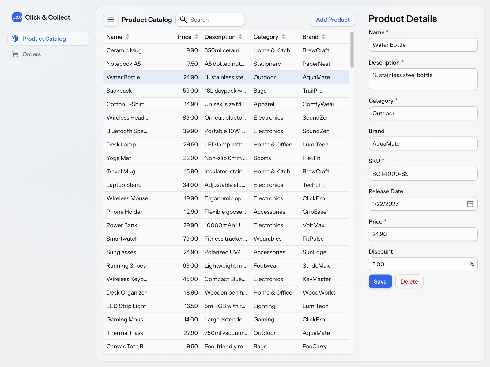

= Getting Started with Vaadin

[.gs-hero]
--
[subs="macros,attributes"]
++++

Vaadin lets you build the web user interface of a Java application in Java, by hand or with an AI coding agent. Both paths below end with a running application. The Tutorial builds the product catalog shown here.

xref:/getting-started/ai-agent#["Start with an AI Agent",role="button primary water"]
xref:/getting-started/tutorial#["Follow the Tutorial",role="button secondary water"]

In a hurry? The link:https://vaadin.com/quickstart[quick start on Vaadin's website] gets a starter running in five minutes.

++++

[.gs-hero-image]

--

Each path uses Spring Boot, because it's the easiest platform to start with. See <<starters#,Starters>> for other ways to create a project, such as Gradle, Spring Initializr, or a template for Quarkus or Jakarta EE, and <<dev-environment#,Development Environment>> to install Java, an IDE, or an AI coding agent. When your application runs, <<next-steps#,Next Steps>> lists the guides that most applications need next.

[.cards.quiet]
== Evaluate Vaadin

[.breakout]
--
Deciding whether Vaadin fits a project? Read these four pages in order. Together, they take about half an hour. To go further, the <<{articles}/building-apps/architecture#,Architecture>> Deep Dives cover how to structure an application with a Vaadin UI, and how to measure capacity and test failover.
--

[.card]
=== 1. When to Use Vaadin

Which applications Vaadin fits, which it doesn't, and why. About 8 minutes.

[.sr-only]
<<{articles}/building-apps/architecture/when-to-use-vaadin#,When to Use Vaadin>>

[.card]
=== 2. How Vaadin Works at Runtime

Where the UI state lives, what each interaction costs, and what that means for deploying and scaling the application. About 15 minutes.

[.sr-only]
<<{articles}/building-apps/architecture/runtime-model#,How Vaadin Works at Runtime>>

[.card]
=== 3. Licensing, Support & Maintenance

Which features are free, which need a commercial subscription, and how Vaadin versions are maintained. About 3 minutes.

[.sr-only]
<<{articles}/building-apps/architecture/licensing-and-maintenance#,Licensing, Support & Maintenance>>

[.card]
=== 4. Supported Technologies

The minimum versions of Java, Spring Boot, and the other technologies that Vaadin works with. About 2 minutes.

[.sr-only]
<<{articles}/compatibility#,Supported Technologies>>

[.cards.quiet]
== Start from Existing Code

[.breakout]
--
You don't need a new project to use Vaadin. If you already have code, start here. For data from a backend that runs as a separate service, see <<{articles}/building-apps/integration/call-remote-services#,Call a Remote Service>>. <<{articles}/tools/swing#,Swing Kit>> and the <<{articles}/tools/modernization-toolkit#,Modernization Toolkit>> help you migrate a Swing application, and <<{articles}/tools/mpr#,Multiplatform Runtime>> runs pass:[<!-- vale Vaadin.Versions = NO -->]Vaadin 7 and 8pass:[<!-- vale Vaadin.Versions = YES -->] views inside a current application while you migrate them.
--

[.card]
=== A Java Application

Add a Vaadin UI next to the application's REST API, security configuration, and JPA entities. The views call the services you already have.

[.sr-only]
<<existing-application#,Add a Vaadin UI to an Existing Application>>

[.card]
=== A REST API

Views call your application services directly, so the UI doesn't need a REST API of its own. Keep serving the API to other systems next to the UI.

[.sr-only]
<<{articles}/building-apps/integration/rest-api#,REST API Alongside Vaadin>>

[.card]
=== A Swing Application

SwingBridge runs it in a browser without a rewrite. Swing Kit renders Vaadin views inside it, so you can replace it one view at a time.

[.sr-only]
<<{articles}/tools/modernization-toolkit/swing-bridge#,SwingBridge>>

[.card]
=== An Older Vaadin Version

The Upgrading Guide lists the changes that an upgrade needs, and compares the major versions to help you assess the effort.

[.sr-only]
<<{articles}/upgrading#,Upgrading Guide>>

++++

++++
