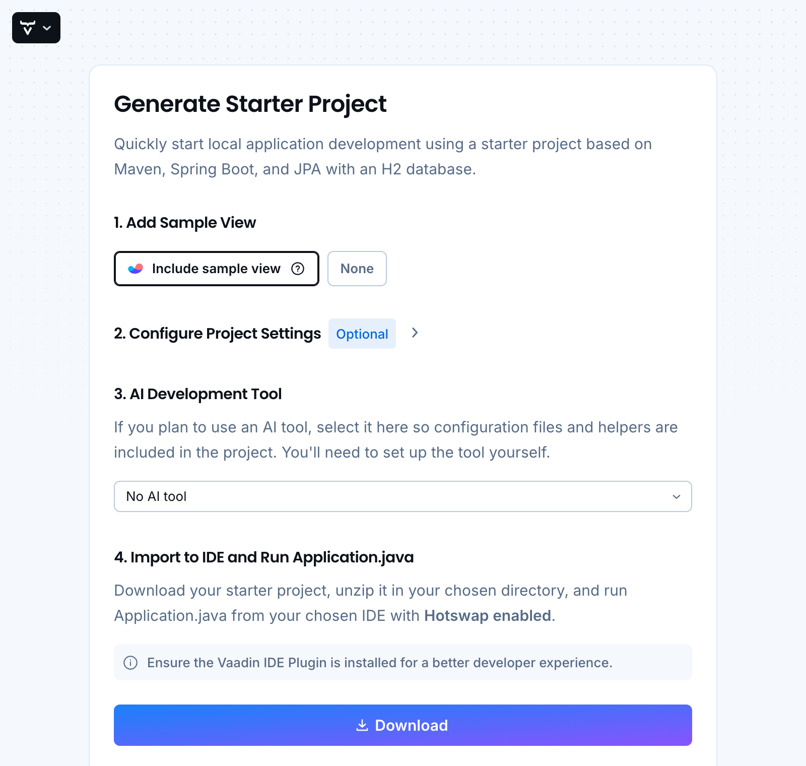

= Create a Project with Vaadin Start

The recommended way to start a project with Vaadin is by using https://start.vaadin.com[Vaadin Start], which generates a ready-to-run Spring Boot and Maven based project:

[.device]

link:https://start.vaadin.com/[Open Vaadin Start, role="button primary water"]

You can choose to include a sample view or create an empty project.

By expanding the *Configure Project Settings* section, you can customize the project settings:

* Select Vaadin version
* Select Java version
* Specify Maven group ID and artifact ID

When you click the [guibutton]*Download* button, a ZIP file containing the generated project is downloaded to your computer. You can then extract the ZIP file and <</getting-started/dev-environment/import#,open the project in your favorite IDE>>.

[[ai-development-tool]]
== AI Development Tool

If you use an AI coding agent, select it under *AI Development Tool*. The project then includes the agent's configuration file for the <<{articles}/building-apps/agentic-development/mcp#,Vaadin MCP server>>, which gives the agent access to Vaadin's documentation, and for a Playwright MCP server, which lets it drive a browser:

[cols="1,2"]
|===
| Agent | File

| Claude Code | [filename]`.mcp.json`
| Codex | [filename]`.codex/config.toml`
| Cursor | [filename]`.cursor/mcp.json`
| GitHub Copilot | [filename]`.vscode/mcp.json`
| Gemini CLI | [filename]`.gemini/settings.json`
|===

For other agents, add the server as described in <<{articles}/building-apps/agentic-development/mcp/supported-tools#,Supported Tools>>. See <<../../dev-environment/ai-agent#,Set Up an AI Agent>> for the rest of the setup, such as the Vaadin Skills plugin for Claude Code and Codex.
