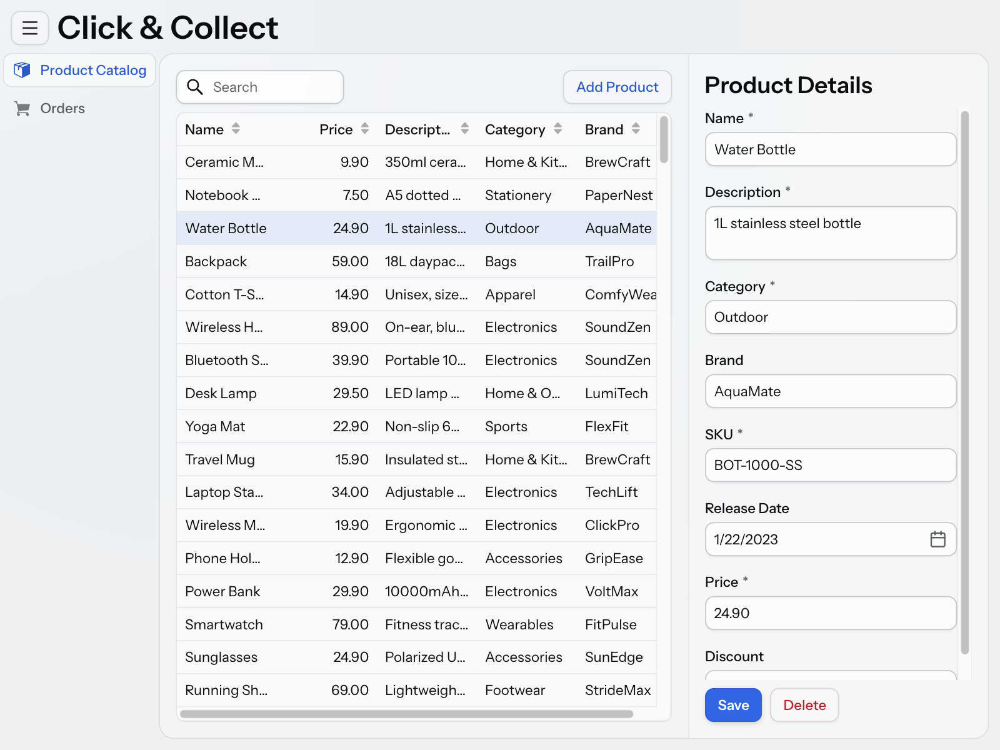

= Add Navigation
:toclevels: 2

So far, the application has only one view: the product catalog. In the full Click & Collect back office, employees would also process customer orders and track deliveries, each in a view of its own. They'd move between the views using a navigation menu that stays on the screen.

In this step, you'll add a main layout with a navigation menu, and show every view inside it. You'll then add a second view for orders, so that there is somewhere to navigate. The orders view is only a placeholder, since building it would repeat what you've already done for the product catalog.

.More Information Available
[TIP]
This step is based on the <</building-apps/views/add-router-layout#,Add a Router Layout>> and <</building-apps/views/add-navi-menu#,Add a Navigation Menu>> guides. Read them if you want more detailed information about layouts and menus in Vaadin.

== Create the Main Layout

A layout that the router shows views inside is called a _router layout_. You'll build yours with the <</components/app-layout#,App Layout>> component. It has a _navigation bar_ at the top and a _drawer_ on the side. You'll put the application name in the navigation bar, and a <</components/side-nav#,Side Navigation>> menu in the drawer.

The layout doesn't belong to any feature, so put it in a package of its own. Create a new package `com.example.base.ui`, and inside it, a class named `MainLayout`:

.MainLayout.java
[source,java]
----
package com.example.base.ui;

import com.vaadin.flow.component.applayout.AppLayout;
import com.vaadin.flow.component.applayout.DrawerToggle;
import com.vaadin.flow.component.html.H1;
import com.vaadin.flow.component.icon.Icon;
import com.vaadin.flow.component.sidenav.SideNav;
import com.vaadin.flow.component.sidenav.SideNavItem;
import com.vaadin.flow.router.Layout;
import com.vaadin.flow.server.menu.MenuConfiguration;

@Layout // <1>
class MainLayout extends AppLayout {

    MainLayout() {
        // Create components
        var toggle = new DrawerToggle(); // <2>
        var title = new H1("Click & Collect");

        var menu = new SideNav();
        MenuConfiguration.getMenuEntries().forEach(entry -> { // <3>
            var item = new SideNavItem(entry.title(), entry.menuClass(), // <4>
                new Icon(entry.icon()));
            item.setMatchNested(true); // <5>
            menu.addItem(item);
        });

        // Layout navigation bar and drawer
        addToNavbar(toggle, title); // <6>
        addToDrawer(menu); // <7>
    }
}
----
<1> `@Layout` makes this the layout of every view in the application, so you don't have to change the views to use it.
<2> On narrow screens, App Layout hides the drawer. The toggle button opens and closes it.
<3> `MenuConfiguration.getMenuEntries()` returns an entry for every view that has a `@Menu` annotation. You'll add the annotation to the views next.
<4> A `SideNavItem` is a link to a view, with a label and an icon. The menu highlights the item of the view that the user is on.
<5> Highlight the item also when the URL continues past the view's path. You'll need this in the next step, when the product ID becomes part of the URL.
<6> Show the toggle button and the application name in the navigation bar.
<7> Show the menu in the drawer.

The layout doesn't refer to any view class. Instead, each view declares its own menu entry with an annotation. This keeps the layout independent of the features. Adding a view to the menu doesn't require changes to the layout, and the layout can link to views in other packages, even though the view classes are package-private.

If you open http://localhost:8080 now, the product catalog appears inside the layout, below the navigation bar. The drawer is still empty, since no view has a `@Menu` annotation yet.

.Layouts and Security
[NOTE]
When you secure the application later, the layout needs an access annotation of its own, such as `@PermitAll`. Otherwise, users are denied access to every view inside it. See <</building-apps/views/add-router-layout#automatic-layouts,Add a Router Layout>> for details.

== Add the Product Catalog to the Menu

To add a view to the menu, annotate it with `@Menu`. At the same time, give the product catalog a path of its own. So far, it has been the root view at `""`, which made sense while it was the only view. When the application has a menu, each view should have its own path, such as `products` and `orders`. This also matters in the next step, where the product ID becomes part of the URL: `products/12` says more than `12`, and the menu can tell that it belongs to the product catalog.

Change the annotations of `ProductCatalogView` as follows. The rest of the class stays the same:

.ProductCatalogView.java
[source,java]
----
// The other imports stay the same
// tag::snippet[]
import com.vaadin.flow.router.Menu;
// end::snippet[]
import com.vaadin.flow.router.PageTitle;
import com.vaadin.flow.router.Route;
// tag::snippet[]
import com.vaadin.flow.router.RouteAlias;
// end::snippet[]

// tag::snippet[]
@Route("products") // <1>
@RouteAlias("") // <2>
// end::snippet[]
@PageTitle("Product Catalog")
// tag::snippet[]
@Menu(order = 1, icon = "vaadin:package") // <3>
// end::snippet[]
class ProductCatalogView extends MasterDetailLayout {
    // The rest of the class stays the same
}
----
<1> The view is now at http://localhost:8080/products.
<2> A route alias is an extra path for the same view. With it, http://localhost:8080 still opens the product catalog.
<3> The menu entry gets its title from `@PageTitle`, and its icon from the <</components/icons#vaadin-icons,Vaadin Icons>> collection. The `order` sets the position of the item in the menu.

The menu now has a [guilabel]*Product Catalog* item. It's highlighted, since you're on the product catalog view.

== Add an Orders View

Next, add a second view, so that there is somewhere to navigate. Orders are a different feature than the product catalog, so they get a package of their own. Create a new package `com.example.order`, and inside it, a class named `OrdersView`:

.OrdersView.java
[source,java]
----
package com.example.order;

import com.vaadin.flow.component.html.Paragraph;
import com.vaadin.flow.component.orderedlayout.VerticalLayout;
import com.vaadin.flow.router.Menu;
import com.vaadin.flow.router.PageTitle;
import com.vaadin.flow.router.Route;

@Route("orders") // <1>
@PageTitle("Orders")
@Menu(order = 2, icon = "vaadin:cart") // <2>
class OrdersView extends VerticalLayout {

    OrdersView() {
        add(new Paragraph("Customer orders will be listed here.")); // <3>
    }
}
----
<1> The view is at http://localhost:8080/orders.
<2> The `order` puts the item below the product catalog in the menu.
<3> The view only shows a short text. A real orders view would have a grid, a form, and a service of its own, like the product catalog has.

The menu now has two items, although you didn't change `MainLayout`:

[.device]

Click the items to move between the views. The URL in the browser changes, and the menu highlights the item of the current view. The browser's Back and Forward buttons work as well.

Now make the browser window narrower. When the window is narrow enough, the drawer disappears. Click the toggle button in the navigation bar to open it on top of the view.

== Complete Code for This Step

If your application doesn't behave as described, compare your files with these listings. This step changes `ProductCatalogView` and adds two classes. The other classes are the same as in the <<add-data#complete-code-for-this-step,complete code of the Add Data step>>.

.ProductCatalogView.java
[%collapsible]
====
[source,java]
----
package com.example.product;

import com.vaadin.flow.component.button.Button;
import com.vaadin.flow.component.grid.ColumnTextAlign;
import com.vaadin.flow.component.grid.Grid;
import com.vaadin.flow.component.icon.VaadinIcon;
import com.vaadin.flow.component.masterdetaillayout.MasterDetailLayout;
import com.vaadin.flow.component.notification.Notification;
import com.vaadin.flow.component.notification.NotificationVariant;
import com.vaadin.flow.component.orderedlayout.HorizontalLayout;
import com.vaadin.flow.component.orderedlayout.VerticalLayout;
import com.vaadin.flow.component.textfield.TextField;
import com.vaadin.flow.data.value.ValueChangeMode;
import com.vaadin.flow.router.Menu;
import com.vaadin.flow.router.PageTitle;
import com.vaadin.flow.router.Route;
import com.vaadin.flow.router.RouteAlias;
import org.springframework.dao.DuplicateKeyException;
import org.springframework.dao.OptimisticLockingFailureException;

@Route("products")
@RouteAlias("")
@PageTitle("Product Catalog")
@Menu(order = 1, icon = "vaadin:package")
class ProductCatalogView extends MasterDetailLayout {

    ProductCatalogView(ProductCatalogService service) {
        // Create components
        var searchField = new TextField();
        searchField.setPlaceholder("Search");
        searchField.setPrefixComponent(VaadinIcon.SEARCH.create());
        searchField.setValueChangeMode(ValueChangeMode.LAZY);

        var grid = new Grid<ProductCatalogItem>();
        grid.addColumn(ProductCatalogItem::name)
            .setHeader("Name")
            .setSortProperty(ProductCatalogItem.SORT_PROPERTY_NAME);
        grid.addColumn(ProductCatalogItem::price)
            .setHeader("Price")
            .setTextAlign(ColumnTextAlign.END)
            .setSortProperty(ProductCatalogItem.SORT_PROPERTY_PRICE);
        grid.addColumn(ProductCatalogItem::description)
            .setHeader("Description")
            .setSortProperty(ProductCatalogItem.SORT_PROPERTY_DESCRIPTION);
        grid.addColumn(ProductCatalogItem::category)
            .setHeader("Category")
            .setSortProperty(ProductCatalogItem.SORT_PROPERTY_CATEGORY);
        grid.addColumn(ProductCatalogItem::brand)
            .setHeader("Brand")
            .setSortProperty(ProductCatalogItem.SORT_PROPERTY_BRAND);
        grid.setItemsPageable(pageable -> service
            .findItems(searchField.getValue(), pageable)
        );

        var drawer = new ProductFormDrawer(productDetails -> {
            var saved = service.save(productDetails);
            grid.getDataProvider().refreshAll();
            return saved;
        }, productDetails -> {
            service.delete(productDetails);
            grid.deselectAll();
            grid.getDataProvider().refreshAll();
        }, this::handleException);

        searchField.addValueChangeListener(e ->
                grid.getDataProvider().refreshAll());

        grid.addSelectionListener(e -> {
            var productDetails = e.getFirstSelectedItem()
                .flatMap(item -> service.findDetailsById(item.productId()));
            productDetails.ifPresent(drawer::setProductDetails);
            setDetail(productDetails.isPresent() ? drawer : null);
        });
        addBackdropClickListener(e -> grid.deselectAll());
        addDetailEscapePressListener(e -> grid.deselectAll());

        var addButton = new Button("Add Product", e ->
                new AddProductDialog(
                        productDetails -> {
                            var saved = service.save(productDetails);
                            grid.getDataProvider().refreshAll();
                            service.findItemById(saved.getProductId())
                                   .ifPresent(grid::select);
                        },
                        this::handleException
                ).open()
        );

        // Layout view
        setSizeFull();
        setDetailSize("300px");
        setExpandMaster(true);

        var toolbar = new HorizontalLayout();
        toolbar.setWidthFull();
        toolbar.addToStart(searchField);
        toolbar.addToEnd(addButton);

        var listLayout = new VerticalLayout(toolbar, grid);
        listLayout.setSizeFull();
        grid.setSizeFull();

        setMaster(listLayout);
    }

    private void handleException(RuntimeException exception) {
        if (exception instanceof OptimisticLockingFailureException) {
            var notification = new Notification(
                "Another user has edited the same product. "
                + "Please refresh and try again.");
            notification.setPosition(Notification.Position.MIDDLE);
            notification.addThemeVariants(NotificationVariant.WARNING);
            notification.setDuration(3000);
            notification.open();
        } else if (exception instanceof DuplicateKeyException) {
            var notification = new Notification(
                "The SKU is already in use. Please enter another one.");
            notification.setPosition(Notification.Position.MIDDLE);
            notification.addThemeVariants(NotificationVariant.WARNING);
            notification.setDuration(3000);
            notification.open();
        } else {
            // Delegate to Vaadin's default error handler
            throw exception;
        }
    }
}
----
====

.MainLayout.java
[%collapsible]
====
[source,java]
----
package com.example.base.ui;

import com.vaadin.flow.component.applayout.AppLayout;
import com.vaadin.flow.component.applayout.DrawerToggle;
import com.vaadin.flow.component.html.H1;
import com.vaadin.flow.component.icon.Icon;
import com.vaadin.flow.component.sidenav.SideNav;
import com.vaadin.flow.component.sidenav.SideNavItem;
import com.vaadin.flow.router.Layout;
import com.vaadin.flow.server.menu.MenuConfiguration;

@Layout
class MainLayout extends AppLayout {

    MainLayout() {
        // Create components
        var toggle = new DrawerToggle();
        var title = new H1("Click & Collect");

        var menu = new SideNav();
        MenuConfiguration.getMenuEntries().forEach(entry -> {
            var item = new SideNavItem(entry.title(), entry.menuClass(),
                new Icon(entry.icon()));
            item.setMatchNested(true);
            menu.addItem(item);
        });

        // Layout navigation bar and drawer
        addToNavbar(toggle, title);
        addToDrawer(menu);
    }
}
----
====

.OrdersView.java
[%collapsible]
====
[source,java]
----
package com.example.order;

import com.vaadin.flow.component.html.Paragraph;
import com.vaadin.flow.component.orderedlayout.VerticalLayout;
import com.vaadin.flow.router.Menu;
import com.vaadin.flow.router.PageTitle;
import com.vaadin.flow.router.Route;

@Route("orders")
@PageTitle("Orders")
@Menu(order = 2, icon = "vaadin:cart")
class OrdersView extends VerticalLayout {

    OrdersView() {
        add(new Paragraph("Customer orders will be listed here."));
    }
}
----
====

== Next Steps

You've added a main layout with a navigation menu, and a second view to navigate to. From now on, every view that you annotate with `@Menu` shows up in the menu without changes to the layout.

In the next step, you'll put the selected product in the URL, so that users can share and bookmark links to individual products. Proceed to the <<deep-link#,Add Deep Linking>> step to continue the tutorial.

link:{articles}/getting-started/tutorial/deep-link[Next: Add Deep Linking, role="button primary water", id="docs-tutorial-add-navigation-next-cta"]
