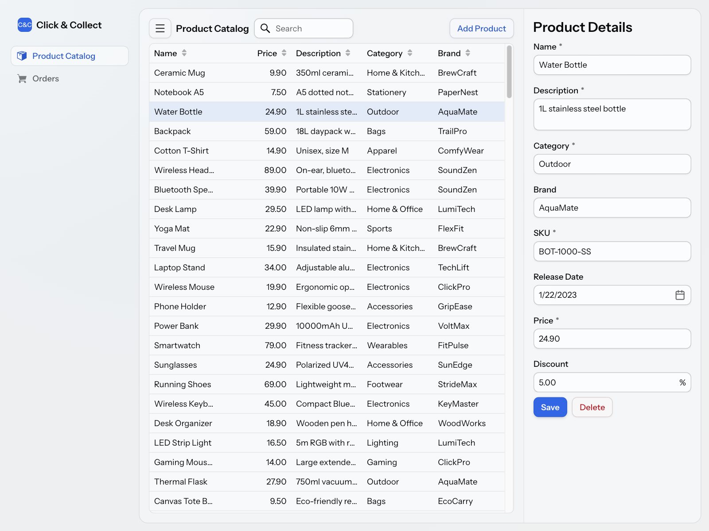

= Welcome to the Vaadin Tutorial

This tutorial guides you through the basics of building a Spring Boot application with a Vaadin UI. You'll start with an empty project and gradually add features to create a functional web application step by step.

If you only want to see Vaadin in action first, the Quick Start gets you from nothing to a running application in about 10 minutes. You don't need to complete it before this tutorial.

link:{articles}/getting-started/quick-start[Try the Quick Start, role="button primary water", id="docs-tutorial-quick-start-cta"]

You write the application in Java. Spring Boot runs it, Spring Data reads and writes its database, and Vaadin builds its user interface. You don't need to know Spring Boot beforehand. The tutorial uses Spring Boot features, such as dependency injection, repositories, and transactions, without teaching them in depth. If one is new to you, the https://docs.spring.io/spring-boot/index.html[Spring Boot documentation] explains it.

One step adds four short CSS rules to style the main layout, and explains each of them. That's all the frontend code you need.

You'll be building parts of the back office of a fictional Click & Collect service for a retail company. In the full back office, employees would manage the product catalog, process customer orders, and track deliveries. In this tutorial, you'll build the product catalog, and the main layout with a navigation menu that the other parts would share:

[.device]

In each step, you'll explore different aspects of Vaadin, including UI components, data binding, navigation, deep linking, testing, and more. Each step builds upon the previous one. Every step ends with the complete code for that step, so you can compare your files with it if something doesn't work as expected. If you are interested in learning how to do a particular task in Vaadin, see the <</building-apps#,Building Apps>> guides instead.

The finished application is in the https://github.com/vaadin/tutorial[`vaadin/tutorial`] repository on GitHub, so you can run it and read its code before you start. The repository also has a branch for every step, with the application as it is at the end of that step. To start the tutorial at a later step, clone the branch of the step before it. For example, to start at <<edit-details#,Edit Details>>, clone the branch of Show Details:

[source,terminal]
----
git clone --branch step/show-details https://github.com/vaadin/tutorial.git
----

Expect to spend 15 to 45 minutes on each step. You don't need to finish the tutorial in one sitting. The application keeps working between steps.

section_outline::[]
